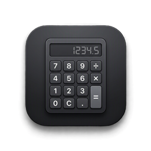

<p align="center">
  
</p>

<h1 align="center">SmartCalculator</h1>

<p align="center">
  <strong>Premium handheld-style scientific calculator for Windows Desktop.</strong><br>
  Built with WPF and .NET 8 — offline, self-contained, portable, and responsive.
</p>

<p align="center">
  <a href="https://github.com/ahmadibrahim4geo/SmartCalculator/releases/tag/v3.0.0"></a>
  
  
  
  
</p>

---

## Highlights in v3.0.0 🚀

- **Developer Arabic Calligraphy Signature ("أحمد إبراهيم")**:
  - The authentic Arabic calligraphy logo from developer Ahmad Ibrahim sits prominently at the center of the calculator header.
  - Rendered as vector geometry with a **100% transparent background**, physical vector cutouts (`CombinedGeometry`), and metallic platinum finish (`#E2E8F0`).
  - Interactive: Hover brightens to pure white (`#FFFFFF`) with a hand cursor, and clicking opens the About & Developer info dialog.
- **Persistent Developer Subtitle**:
  - `Scientific Display • by: Ahmad Ibrahim` remains clearly visible below the application title in **both Full mode and Compact mode**.
- **Complete Compact Mode (Mini-Calculator)**:
  - Space-saving mini-calculator featuring a uniform **4×6 keypad** with essential functions: parentheses `(`, `)`, square root `√`, percentage `%`, `S⇔D` fraction toggle, clear/delete keys, and full arithmetic.
  - Instant toggle via global hotkey **Ctrl+M**, the header icon `⤡`/`⤢`, or menu `MODE → ▶ → 6:COMPACT`.
- **130 Unique Visual Themes**:
  - 30 brand-new premium palettes added, totaling 130 distinct themes managed by a unified `ThemeCatalog`.
  - Dynamic palette preview, numeric selection, and cycle (`🎨`) / hold-for-list controls.
- **20 Independent Ergonomic Key & Navigator Skins**:
  - Authentic physical button profiles: Classic Scientific, Modern ClassWiz Soft, Raised 3D, Graphing Pro, Precision Chamfer, Mechanical Keycap, Glass Aero, Metallic Bevel, Retro Desktop, Chiclet, and High-Contrast.
  - Safe 5px label margins ensuring **zero clipping** of secondary yellow `SHIFT` and red `ALPHA` labels.
  - Navigators completely enclose the `NAV` button with zero distortion.
- **Startup Stability & Performance**:
  - Resolved startup crash exceptions, ensuring immediate, smooth launch across all systems.
- **Persistent Preferences**:
  - Settings (Theme, Skin, Compact Mode, Always-on-Top) are stored in `%LocalAppData%\SmartCalculator\settings.json` and restored automatically on launch.
- **Classic Fixed LCD**:
  - The calculation display maintains its authentic green scientific appearance across all 130 themes and 20 skins.
- **Audited Mathematical Engine**:
  - Corrected `SHIFT+xʸ` to `root(value,index)`, `SHIFT+log` to `10^(`, and `SHIFT+ENG` to move cursor left.
  - Real cube roots for negative values and strict `Syntax Error` reporting for invalid tokens.
  - 822 automated regression tests passing with 0 failures.

---

## Download & Installation

Pre-compiled self-contained x64 binaries are available directly in [`release/v3.0.0/`](release/v3.0.0/):

| Package | File | Description |
|---|---|---|
| **Setup Installer** | [`SmartCalculator_Setup_v3.0.0.exe`](release/v3.0.0/SmartCalculator_Setup_v3.0.0.exe) | Standard Windows installer with desktop shortcuts and uninstaller. |
| **Portable ZIP** | [`SmartCalculator_Portable_v3.0.0.zip`](release/v3.0.0/SmartCalculator_Portable_v3.0.0.zip) | Standalone portable archive; extract and run without installation. |
| **Checksums** | [`SHA256SUMS_v3.0.0.txt`](release/v3.0.0/SHA256SUMS_v3.0.0.txt) | SHA-256 integrity hashes for verification. |

> [!NOTE]
> Both packages are self-contained Windows x64 distributions and **do not require** .NET Desktop Runtime or any external dependencies to be installed.

### SHA-256 Checksums
```text
1b9221170e9e76a3f7189acfe75e220993cbbc20f4a0b25065439355ebeaf974  SmartCalculator_Setup_v3.0.0.exe
00eb92c0893ad7aecddc936f8f9864a05411289c4a7e0cf4c4ddd2c9af4c851e  SmartCalculator_Portable_v3.0.0.zip
```

---

## Operating Modes

Press `MODE` to access the calculation modes:

### Page 1 (Calculation Modes)
1. **COMP**: General arithmetic and scientific evaluation.
2. **CMPLX**: Complex number calculations with imaginary unit `i`.
3. **STAT**: Statistical analysis (single-variable summary).
4. **BASE-N**: Number base conversion (HEX, DEC, OCT, BIN) with bitwise logic.
5. **EQN**: Numerical equation solving.
6. **MATRIX**: Matrix manipulation, determinants, and inversion.
7. **TABLE**: Function evaluation and numerical table generation $f(x)$.
8. **VECTOR**: 2D/3D vector mathematics (dot, cross, norm).

### Page 2 (Appearance & Setup — press `▶`)
4. **THEME**: Visual theme selector (130 themes).
5. **SKIN**: Button skin selector (20 physical skins).
6. **COMPACT**: Instant toggle for Compact Mini-Calculator mode.

---

## Keyboard Shortcuts

| Shortcut | Action |
|---|---|
| `0` - `9` | Digits input |
| `+`, `-`, `*`, `/` | Basic arithmetic operators |
| `Enter` or `=` | Compute expression result |
| `Backspace` | Delete character at cursor (`DEL`) |
| `Escape` | Clear all calculation input (`AC`) |
| `Arrow Keys` | Move cursor (`Left`/`Right`), scroll history (`Up`/`Down`) |
| `Ctrl + M` | Toggle Compact / Full mode |
| `F1` | Open built-in Help Manual |

---

## Building from Source

### Prerequisites
- Windows 10 or 11 (64-bit)
- [.NET 8.0 SDK](https://dotnet.microsoft.com/download/dotnet/8.0)
- Inno Setup 6 (optional, required only for building the installer)

### Build Debug Executable
```powershell
dotnet build
```
Output: `bin\Debug\net8.0-windows\SmartCalculator.exe`

### Run Test Suite (822 Tests)
```powershell
dotnet run --project test-runners/regression-runner.csproj
```

### Build Complete Release (Installer + Portable)
```powershell
.\tools\Build-V3Release.ps1
```

---

## Author & Credits

- **Developer**: Ahmad Ibrahim ([@ahmadibrahim4geo](https://github.com/ahmadibrahim4geo))
- **Repository**: [https://github.com/ahmadibrahim4geo/SmartCalculator](https://github.com/ahmadibrahim4geo/SmartCalculator)
- **License**: [MIT License](LICENSE)
